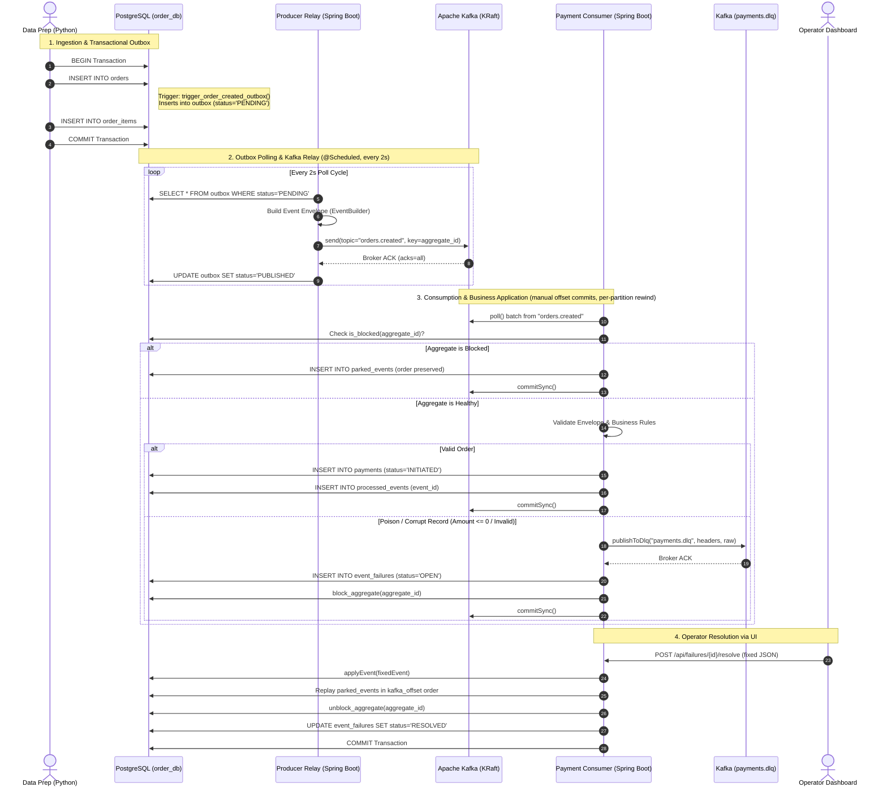

# End-to-End Order Processing Flow & Architecture

This document describes the complete lifecycle of an order across PostgreSQL, Kafka, the Python data generation pipeline, and the Spring Boot producer and consumer microservices.

---

## 1. System Architecture Diagram



---

## 2. Infrastructure Initialization

The infrastructure runs locally via Docker Compose defined in [docker-compose.yml](docker-compose.yml#L1-L143).

### 2.1 PostgreSQL 17
* **Container**: `zero-outbox-postgres`
* **Port**: `5434` mapped to internal `5432` (`${POSTGRES_PORT:-5434}:5432`) ([docker-compose.yml](docker-compose.yml#L10-L11))
* **Schema Mount**: Mounts [schema.sql](schema.sql#L1-L222) to `/docker-entrypoint-initdb.d/01_schema.sql` on startup.
* **Healthcheck**: Uses `pg_isready -U postgres -d order_db` ([docker-compose.yml](docker-compose.yml#L15-L19)).

### 2.2 Apache Kafka 4.4.0 (3-Broker KRaft Cluster)
* **Brokers**:
  * `zero-outbox-kafka-1` (Node ID: 1, Host Port: `9092`, Controller: `29093`) ([docker-compose.yml](docker-compose.yml#L21-L53))
  * `zero-outbox-kafka-2` (Node ID: 2, Host Port: `9094`, Controller: `29093`) ([docker-compose.yml](docker-compose.yml#L54-L86))
  * `zero-outbox-kafka-3` (Node ID: 3, Host Port: `9096`, Controller: `29093`) ([docker-compose.yml](docker-compose.yml#L87-L119))
* **Mode**: KRaft without Zookeeper (`KAFKA_PROCESS_ROLES: "broker,controller"`), controller quorum voters across all 3 nodes.
* **Replication & Fault Tolerance**:
  * `default.replication.factor: 3`, `min.insync.replicas: 2`, `offsets.topic.replication.factor: 3`.
  * Guarantees high availability: survives loss of any single broker without downtime or data loss.

### 2.3 Automated Topic Initialization
The `kafka-init` service depends on `kafka-1`, `kafka-2`, and `kafka-3` being healthy, then creates topics with 3 partitions, replication factor 3, and `min.insync.replicas=2` ([docker-compose.yml](docker-compose.yml#L120-L138)):
```bash
/opt/kafka/bin/kafka-topics.sh --bootstrap-server kafka-1:19092 --create --if-not-exists --topic orders.created --partitions 3 --replication-factor 3 --config min.insync.replicas=2
/opt/kafka/bin/kafka-topics.sh --bootstrap-server kafka-1:19092 --create --if-not-exists --topic payments.dlq --partitions 3 --replication-factor 3 --config min.insync.replicas=2
```

---

## 3. Order Ingestion & Transactional Outbox (Python Data-Prep)

Orders originate from the synthetic order generator and loader in Python.

### 3.1 Order Generation
In [data-prep/src/data_prep/generate_orders.py](data-prep/src/data_prep/generate_orders.py#L34-L77), `generate_single_order()` creates an order record:
* Generates a unique `order_id` (UUID), `order_number` (`ORD-YYYYMMDD-XXXXXX`), and customer details via Faker.
* Selects 1 to 4 random catalog products, calculating line item subtotals and `total_amount` in `INR`.

### 3.2 Atomic Insertion & DB Trigger
In [data-prep/src/data_prep/load_orders.py](data-prep/src/data_prep/load_orders.py#L46-L106), `insert_order()` executes within a single ACID transaction (`with conn.transaction():`):

```python
# 1. Insert into orders table (Fires the PostgreSQL Trigger)
cur.execute("""
    INSERT INTO orders (id, order_number, customer_id, customer_name, customer_email,
                        total_amount, currency, status, created_at, updated_at)
    VALUES (%s, %s, %s, %s, %s, %s, %s, %s, %s, %s)
""", (...))

# 2. Insert line items
for item in items:
    cur.execute("""
        INSERT INTO order_items (id, order_id, product_id, product_name, quantity, unit_price, subtotal)
        VALUES (%s, %s, %s, %s, %s, %s, %s)
    """, (...))
```

### 3.3 The Outbox Trigger (`schema.sql`)
The PostgreSQL trigger [trg_order_created_outbox](schema.sql#L147-L151) fires `AFTER INSERT ON orders FOR EACH ROW` and executes [trigger_order_created_outbox()](schema.sql#L107-L144):
```sql
INSERT INTO outbox (
    aggregate_type,
    aggregate_id,
    event_type,
    topic,
    payload,
    status,
    created_at
) VALUES (
    'ORDER',
    NEW.id,
    'OrderCreated',
    'orders.created',
    jsonb_build_object(
        'order_id', NEW.id,
        'order_number', NEW.order_number,
        'customer_id', NEW.customer_id,
        'customer_name', NEW.customer_name,
        'customer_email', NEW.customer_email,
        'total_amount', NEW.total_amount,
        'currency', NEW.currency,
        'status', NEW.status,
        'payment_trigger', jsonb_build_object(
            'action', 'INITIATE_PAYMENT',
            'amount', NEW.total_amount,
            'currency', NEW.currency,
            'target_account', NEW.customer_id
        )
    ),
    'PENDING',
    NEW.created_at
);
```
> [!IMPORTANT]
> The order and its outbox event are committed atomically in the same database transaction. A broker outage or application crash cannot cause a dual-write inconsistency.

---

## 4. Outbox Relay Producer (Spring Boot)

The Spring Boot producer ([producer-spring/](producer-spring)) runs continuously to transport events from PostgreSQL to Kafka.

### 4.1 Polling Loop
The poll cycle runs on a Spring `@Scheduled` fixed-delay timer (default every 2 s, `app.outbox.poll-interval`) and calls:

1. `OutboxRelay.processBatch()` ([producer-spring/src/main/java/com/zero/producer/service/OutboxRelay.java#L49](producer-spring/src/main/java/com/zero/producer/service/OutboxRelay.java#L49)):
   ```sql
   SELECT id, aggregate_type, aggregate_id, event_type, payload, created_at
   FROM outbox
   WHERE status = 'PENDING'
   ORDER BY created_at, id
   LIMIT ?
   ```
   Implemented with `JdbcTemplate` in [producer-spring/src/main/java/com/zero/producer/repository/DatabaseClient.java#L62](producer-spring/src/main/java/com/zero/producer/repository/DatabaseClient.java#L62-L86).

### 4.2 Event Envelope Construction
[producer-spring/src/main/java/com/zero/producer/service/EventBuilder.java](producer-spring/src/main/java/com/zero/producer/service/EventBuilder.java#L41-L88) builds the standardized CloudEvents-like envelope:
* Separates `payment_trigger` from order attributes.
* Formats timestamps to ISO-8601 strings.
* Sets `source: "order-service"`, `event_version: 1`, `aggregate_type: "ORDER"`, and `aggregate_id`.

```json
{
  "event_id": "e621fcb3-e517-4f48-b2f7-58b66bd801aa",
  "event_type": "OrderCreated",
  "event_version": 1,
  "occurred_at": "2026-11-17T06:09:55.123Z",
  "aggregate_type": "ORDER",
  "aggregate_id": "dcae324d-b66f-480a-b57d-f5fb876738e2",
  "source": "order-service",
  "data": {
    "order": {
      "order_id": "dcae324d-b66f-480a-b57d-f5fb876738e2",
      "order_number": "ORD-20261117-877222",
      "customer_id": "CUST-6224",
      "customer_name": "Kayla Rocha",
      "customer_email": "rocha@example.com",
      "total_amount": 447.00,
      "currency": "INR",
      "status": "CREATED"
    },
    "payment_trigger": {
      "action": "INITIATE_PAYMENT",
      "amount": 447.00,
      "currency": "INR",
      "target_account": "CUST-6224"
    }
  }
}
```

### 4.3 Synchronous Kafka Publishing
In [producer-spring/src/main/java/com/zero/producer/kafka/KafkaPublisher.java](producer-spring/src/main/java/com/zero/producer/kafka/KafkaPublisher.java#L44-L62):
* The message is keyed with `aggregateId` ensuring all events for the same order route to the same Kafka partition in strict order.
* Producer is configured with `acks="all"` and `enable.idempotence=true` (`spring.kafka.producer.acks` / `spring.kafka.producer.properties.enable.idempotence` in [producer-spring/src/main/resources/application.yml](producer-spring/src/main/resources/application.yml#L18-L24)).
* Blocks on `kafkaTemplate.send(...).get(120, TimeUnit.SECONDS)` to guarantee broker persistence before proceeding.

### 4.4 Status Transition
* **On Success**: Calls [producer-spring/src/main/java/com/zero/producer/repository/DatabaseClient.java](producer-spring/src/main/java/com/zero/producer/repository/DatabaseClient.java#L69-L80) (`markPublished()`) executing:
  ```sql
  UPDATE outbox
  SET status = 'PUBLISHED', published_at = CURRENT_TIMESTAMP, error_message = NULL
  WHERE id = ? AND status = 'PENDING'
  ```
* **On Publish Failure**: Calls [producer-spring/src/main/java/com/zero/producer/repository/DatabaseClient.java](producer-spring/src/main/java/com/zero/producer/repository/DatabaseClient.java#L82-L97) (`recordPublishFailure()`), incrementing `retry_count` and saving the exception message while leaving the row `PENDING` for redelivery.

---

## 5. Payment Consumer Pipeline (Spring Boot)

The Spring Boot consumer ([consumer-spring/](consumer-spring)) processes records with manual offset commits to guarantee at-least-once processing.

### 5.1 Consumption Loop & Per-Partition Offset Management
The consumer is started by Spring (`ConsumerSpringApplication`) with two modes, and the raw `KafkaConsumer` is created from `KafkaProperties.buildConsumerProperties()` (`spring.kafka.consumer.*`):
* **Continuous**: `ConsumerWorker` (a `SmartLifecycle`) starts a background thread on app startup ([consumer-spring/src/main/java/com/zero/consumer/kafka/ConsumerWorker.java#L50-L57](consumer-spring/src/main/java/com/zero/consumer/kafka/ConsumerWorker.java#L50-L57)); graceful stop on context close (`stop()` → `wakeup()`).
* **Single Batch (`--once`)**: `OnceConsumerRunner` (an `ApplicationRunner`) processes the first non-empty batch (or waits ~3 s for group assignment to settle) and shuts the app down ([consumer-spring/src/main/java/com/zero/consumer/kafka/OnceConsumerRunner.java#L43-L77](consumer-spring/src/main/java/com/zero/consumer/kafka/OnceConsumerRunner.java#L43-L77)).

**Per-Partition Batch Processing (`processBatch`)** — the offset-management logic is ported verbatim and unit-tested ([consumer-spring/src/main/java/com/zero/consumer/kafka/BatchProcessor.java#L42-L90](consumer-spring/src/main/java/com/zero/consumer/kafka/BatchProcessor.java#L42-L90); tests in [consumer-spring/src/test/java/com/zero/consumer/kafka/BatchProcessorTest.java](consumer-spring/src/test/java/com/zero/consumer/kafka/BatchProcessorTest.java)):
```java
for (TopicPartition tp : records.partitions()) {
    for (ConsumerRecord<byte[], byte[]> record : records.records(tp)) {
        ...
    }
}
```
* **Contiguous Per-Record Offset Commits**:
  Only after a durable outcome is achieved (applied, duplicate, parked, or DLQ'd) does the consumer commit the exact next offset for that partition:
  ```java
  consumer.commitSync(Collections.singletonMap(tp, new OffsetAndMetadata(record.offset() + 1)));
  ```
* **Partition Rewind (`seek`) on Failure**:
  If [consumer-spring/src/main/java/com/zero/consumer/exception/OffsetRejectException.java](consumer-spring/src/main/java/com/zero/consumer/exception/OffsetRejectException.java#L1-L10) is caught (e.g., DB failure or DLQ write failure):
  1. The consumer executes `consumer.seek(tp, record.offset())` to rewind Kafka's pointer back to the failed record.
  2. Stops processing further records on that specific partition for this batch (`break`).
  3. **Fault Isolation**: Other independent partitions in the same batch continue processing without interruption.
  4. Guarantees strict at-least-once delivery with zero skipped messages.

### 5.2 Three-Stage Processing Pipeline ([consumer-spring/src/main/java/com/zero/consumer/service/Pipeline.java](consumer-spring/src/main/java/com/zero/consumer/service/Pipeline.java#L52-L147))

```
Incoming Kafka Record
        |
        v
[1. Parse JSON] -------- (Malformed JSON) ---------> [Route to DLQ (No Aggregate Block)]
        |
        +---- (Valid JSON)
        |
        v
[2. Block Check] ------- (Aggregate Blocked) -------> [Park in parked_events (Offset Committed)]
        |
        +---- (Aggregate Not Blocked)
        |
        v
[3. Validate & Apply] -- (Permanent Error: <=0 INR) -> [Route to DLQ + Block Aggregate + Ledger]
        |
        +---- (Transient DB Error) -----------------> [Retry with Exponential Backoff + Jitter]
        |
        +---- (Success / Duplicate) ----------------> [Write payments & processed_events]
        |
        v
Commit Kafka Offset (commitSync)
```

#### Stage 1: Parse
* If the raw payload cannot be parsed as a JSON object, it is immediately routed to the DLQ as a `VALIDATION` failure via `failEvent()` without blocking any aggregate (since no valid `aggregate_id` can be identified).

#### Stage 2: Aggregate Block Check & Follower Parking
* If the order has an `aggregate_id`, the consumer checks whether the aggregate is blocked:
  ```sql
  SELECT is_blocked FROM aggregate_processing_state
  WHERE aggregate_type = ? AND aggregate_id = ?
  ```
  ([consumer-spring/src/main/java/com/zero/consumer/repository/DatabaseClient.java](consumer-spring/src/main/java/com/zero/consumer/repository/DatabaseClient.java#L50-L68)).
* If blocked, the event is a **follower** of an unresolved poison event. To preserve strict ordering, it is parked via `db.parkEvent()` in [schema.sql](schema.sql#L160-L176) (`parked_events`) with its `kafka_offset`.
* The consumer commits the offset and proceeds. The follower will be replayed later in exact `kafka_offset` order when the operator resolves the poison failure.

#### Stage 3: Event Validation & Atomic Apply
[consumer-spring/src/main/java/com/zero/consumer/service/EventValidator.java](consumer-spring/src/main/java/com/zero/consumer/service/EventValidator.java#L40-L133) validates domain constraints:
* `event_id` and `aggregate_id` must be valid UUIDs.
* `payment_trigger.action` must equal `"INITIATE_PAYMENT"`.
* `payment_trigger.amount` must be a positive number (`> 0`). Non-positive amounts raise [consumer-spring/src/main/java/com/zero/consumer/exception/BusinessRuleException.java](consumer-spring/src/main/java/com/zero/consumer/exception/BusinessRuleException.java#L1-L17) (permanent error).
* `currency` must be a 3-letter uppercase ISO code (e.g., `INR`).

[consumer-spring/src/main/java/com/zero/consumer/repository/DatabaseClient.java](consumer-spring/src/main/java/com/zero/consumer/repository/DatabaseClient.java#L137-L170) (`applyEvent()`) applies the payment atomically with `payments` + `processed_events` inserts in one Spring `@Transactional` transaction:
1. **Deduplication**: Checks if `event_id` exists in `processed_events`. If yes, returns `"duplicate"`.
2. **Payment Creation**: Inserts into `payments` table with `status = 'INITIATED'` and `idempotency_key = event_id`.
3. **Ledger Record**: Inserts into `processed_events` table (`event_id`, `consumer_name`, `aggregate_id`).

---

## 6. Dead-Letter Queue (DLQ) & Fault Tolerance

When an unrecoverable failure occurs (such as a negative order amount or malformed schema):

### 6.1 DLQ Publisher ([consumer-spring/src/main/java/com/zero/consumer/kafka/DlqPublisher.java](consumer-spring/src/main/java/com/zero/consumer/kafka/DlqPublisher.java#L97-L163))
1. Publishes a self-contained diagnostic message to topic `payments.dlq` via the dedicated DLQ `KafkaTemplate` (`client.id` suffixed `-dlq`, `acks=all` + idempotence from `spring.kafka.producer.*` — see [consumer-spring/src/main/java/com/zero/consumer/config/DlqKafkaConfig.java](consumer-spring/src/main/java/com/zero/consumer/config/DlqKafkaConfig.java)).
2. Sets Kafka headers: `failure_class`, `consumer_name`, `event_id`, `aggregate_id`.
3. The message body contains:
   * Original coordinates: `source_topic`, `source_partition`, `source_offset`.
   * Truncated raw payload (`raw_payload` up to 10,000 characters).
   * Exact failure reason and class (`BUSINESS_RULE` or `VALIDATION`).
4. Requires broker acknowledgement before the consumer proceeds.

### 6.2 Atomic Failure Record & Aggregate Blocking
[consumer-spring/src/main/java/com/zero/consumer/repository/DatabaseClient.java](consumer-spring/src/main/java/com/zero/consumer/repository/DatabaseClient.java#L370-L392) (`recordFailureAndBlock()`, `@Transactional`) executes inside one ACID transaction:
1. **Insert into `event_failures`**: Stores the failure record with `status = 'OPEN'`.
2. **Upsert `aggregate_processing_state`**: Sets `is_blocked = TRUE`, records `blocked_reason`, and links `blocked_event_id`.

```sql
INSERT INTO aggregate_processing_state
    (aggregate_type, aggregate_id, is_blocked, blocked_event_id, blocked_reason, blocked_at, blocked_by_consumer, updated_at)
VALUES (?, ?, TRUE, ?, ?, NOW(), ?, NOW())
ON CONFLICT (aggregate_type, aggregate_id) DO UPDATE SET
    is_blocked = TRUE,
    blocked_event_id = EXCLUDED.blocked_event_id,
    blocked_reason = EXCLUDED.blocked_reason,
    blocked_at = NOW(),
    updated_at = NOW()
```

---

## 7. Operational Dashboard & Resolution Flow

The consumer embeds a Spring Boot web app on port `8090` (`server.port` / `server.address` from `DASHBOARD_PORT` / `DASHBOARD_HOST`, default `8090` / `127.0.0.1` — see [consumer-spring/src/main/resources/application.yml](consumer-spring/src/main/resources/application.yml#L32-L35)):

### 7.1 Real-Time Dashboard UI
* Served at `GET http://127.0.0.1:8090` — the embedded HTML page is now a static resource: [consumer-spring/src/main/resources/static/index.html](consumer-spring/src/main/resources/static/index.html).
* REST endpoints are `@RestController` routes in [consumer-spring/src/main/java/com/zero/consumer/controller/DashboardController.java](consumer-spring/src/main/java/com/zero/consumer/controller/DashboardController.java#L36-L260): `/api/metrics`, `/api/failures`, `/api/blocked`, `/api/parked`, `/api/payments`, `/api/ledger`, `/healthz`, `/readyz`. Display shows real-time metrics, failure lists, blocked aggregates, parked followers, and recent payments.

### 7.2 Fault Injection CLI
Run [consumer-spring/src/main/java/com/zero/consumer/cli/FaultInjector.java](consumer-spring/src/main/java/com/zero/consumer/cli/FaultInjector.java#L32) (standalone main class, not a Spring bean):
```bash
mvn spring-boot:run -Dspring-boot.run.main-class=com.zero.consumer.cli.FaultInjector
# custom: mvn spring-boot:run -Dspring-boot.run.main-class=com.zero.consumer.cli.FaultInjector -Dspring-boot.run.arguments="--followers 3"
```
* Publishes a corrupt event with `amount = -50.0` followed by 2 valid follower events (`amount = 99.0`) for an existing order ID.
* The consumer sends the corrupt event to the DLQ, blocks the aggregate, and parks both followers.

### 7.3 Resolving a Failure in One Transaction
In [consumer-spring/src/main/java/com/zero/consumer/service/FailureResolutionService.java](consumer-spring/src/main/java/com/zero/consumer/service/FailureResolutionService.java#L47-L128) (`resolveFailure()`, `@Transactional`):
1. **Operator Edit**: The operator edits the payload in the UI (e.g., changes amount to `50.0`) and clicks **Apply & Unblock**.
2. **Validation**: The fixed event is validated against business rules before opening the transaction.
3. **Locking**: Selects the failure `FOR UPDATE` to prevent concurrent resolutions.
4. **Apply Fix**: Applies the fixed event via `applyEvent(fixedEvent)`.
5. **Replay Parked Followers**: Queries `parked_events` for the aggregate and applies them in strict `kafka_offset` order. Marks rows `REPLAYED`.
6. **Unblock Aggregate**: Calls `unblockAggregate()`, flipping `is_blocked = FALSE` and setting resolution metadata.
7. **Mark Resolved**: Updates `event_failures` to `status = 'RESOLVED'`.
8. **Commit**: All steps commit together. If any follower fails, the transaction rolls back, keeping the aggregate paused.

---

## 8. Reliability Testing & Cluster Reconciliation (`reliability`)

The `reliability` module provides an automated verification and audit suite ([reliability/](reliability)) to test cluster partition tolerance, broker failovers, and reconcile end-to-end ledger consistency. (Unchanged — still plain Java tooling.)

### 8.1 Key Reliability Operations ([ExperimentCLI.java](reliability/src/main/java/com/zero/reliability/ExperimentCLI.java))
* **Database Snapshot (`snapshot-db`)**:
  Captures a complete point-in-time snapshot of the database state including orders, pending outbox, published outbox, payments, and parked events ([DatabaseSnapshotClient.java](reliability/src/main/java/com/zero/reliability/db/DatabaseSnapshotClient.java)).
* **Kafka Cluster Inspection (`inspect-kafka`)**:
  Connects to all 3 brokers, inspecting partition leader distribution, In-Sync Replicas (ISR), log end offsets, and consumer group commit lag across `orders.created` and `payments.dlq` ([KafkaClusterInspector.java](reliability/src/main/java/com/zero/reliability/kafka/KafkaClusterInspector.java)).
* **Reconciliation Engine (`reconcile`)**:
  Cross-checks database orders and outbox rows against Kafka partition log offsets and payment records. Verifies:
  1. **Zero Message Loss**: Every `PUBLISHED` outbox record exists in Kafka and is represented in `payments` or `event_failures`.
  2. **Deduplication Correctness**: No duplicate payments created despite network retries.
  3. **Strict Partition Ordering**: Outbox events per aggregate follow monotonic sequence.
  Generates a detailed structured audit report ([ReconciliationEngine.java](reliability/src/main/java/com/zero/reliability/reconciliation/ReconciliationEngine.java)).

```bash
# Capture full cluster & DB snapshot before/after experiment
mvn -pl reliability exec:java -Dexec.args="capture-state target/experiment-pre"

# Run ledger reconciliation
mvn -pl reliability exec:java -Dexec.args="reconcile"
```

---

## 9. Summary Table of Microservice Commands

| Task | Command |
|---|---|
| **Build both Spring Boot modules** | `mvn -f producer-spring/pom.xml package && mvn -f consumer-spring/pom.xml package` |
| **Run all unit & integration tests** | `mvn -f producer-spring/pom.xml test && mvn -f consumer-spring/pom.xml test` |
| **Start full stack (infra + services)** | `./dev.sh` (spring stack by default; `STACK=legacy ./dev.sh` for the old services) |
| **Generate & load orders (Python)** | `cd data-prep && uv run test-load -c 20` |
| **Run Producer Relay (Continuous)** | `java -jar producer-spring/target/producer-spring-1.0.0.jar` |
| **Run Producer Relay (Single batch)** | `java -jar producer-spring/target/producer-spring-1.0.0.jar --once` |
| **Run Consumer + Dashboard (Continuous)** | `java -jar consumer-spring/target/consumer-spring-1.0.0.jar` |
| **Run Consumer (Poll once & exit)** | `java -jar consumer-spring/target/consumer-spring-1.0.0.jar --once` |
| **Simulate Poison Event (Fault Injector)**| `mvn -f consumer-spring/pom.xml spring-boot:run -Dspring-boot.run.main-class=com.zero.consumer.cli.FaultInjector` |
| **Run Reliability Cluster Reconciliation**| `mvn -pl reliability exec:java -Dexec.args="reconcile"` |
| **Open Web Dashboard** | `http://localhost:8090` |

